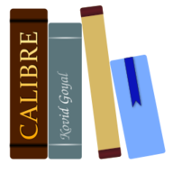

# Calibre 📚

Calibre is a powerful and easy to use e-book manager.

[Calibre](https://calibre-ebook.com/) is a powerful, open-source e-book
manager. This Home Assistant app packages the **full Calibre desktop**—library
management, metadata editing, format conversion and the e-book viewer—into an
all-in-one container. [Selkies](https://docs.linuxserver.io/selkies/) streams
the desktop to your browser over HTTPS, so no external database, desktop
installation or VNC client is needed.

## ✨ Features

- Full Calibre desktop in a modern browser on **amd64** and **aarch64**
- First-run wizard for creating or opening a Calibre library
- Optional Calibre Content server and OPDS catalog on port `8081`
- Browser file uploads, clipboard, fullscreen and adjustable stream quality
- Read/write access to Home Assistant `/media` and `/share` folders
- Optional local disk and SMB/CIFS/NFS storage mounts
- Optional GPU acceleration and advanced Selkies environment settings

## 🚀 Quick start

1. Install and start the app.
2. Select **Open Web UI**, or visit
   `https://<home-assistant-address>:8181`.
3. Accept the expected self-signed certificate warning.
4. In Calibre's setup wizard, use **`/config/Calibre Library`** for the
   simplest installation, or an empty shared folder such as
   **`/share/calibre/Calibre Library`** if Calibre Web will use the library.
   For a shared library, align `PUID`/`PGID` in both apps before importing
   books if Calibre Web needs write access.
5. Add books through Calibre's **Add books** button.

> [!WARNING]
> The desktop Web UI has **no password by default**. Set **both** `CUSTOM_USER`
> and `PASSWORD` to enable HTTP basic authentication. Do not expose the desktop
> directly to the internet; use a VPN or a secured reverse proxy.

## 🔁 Integrations

- Use **[Calibre Web](../calibre-web/DOCS.md)** with a shared library for
  polished reading and multi-user access.
- Use **Nextcloud** or **Syncthing** to provide an import folder and keep
  backup copies.
- Use **Cloudflared** for secured remote access without router port forwarding.
- Connect OPDS readers and KOReader through Calibre's optional Content server.

If you only need a lightweight web reader for an existing library, see the
companion **[Calibre Web](../calibre-web/DOCS.md)** app. For a small HTML/OPDS
catalog, [COPS](https://github.com/mikespub-org/seblucas-cops) is another
alternative. The documentation includes a comparison to help you choose.

Additional resources:

- [Official Calibre user manual](https://manual.calibre-ebook.com/)
- [LinuxServer.io Calibre image](https://docs.linuxserver.io/images/docker-calibre/)
- [Report an app issue](https://github.com/fabio-garavini/hassio-addons/issues)

<!-- APP_AUTHOR_START -->

<table>
  <tr>
    <td width="120" align="center" valign="bottom">
      
    </td>
    <td valign="middle">
      <h3>App made by Fabio Garavini</h3>
      
Help me create free and open-source Home Assistant apps for everyone!

      
    </td>
  </tr>
</table>
<!-- APP_AUTHOR_END -->
